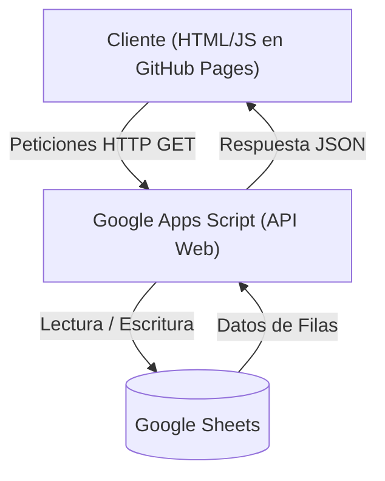
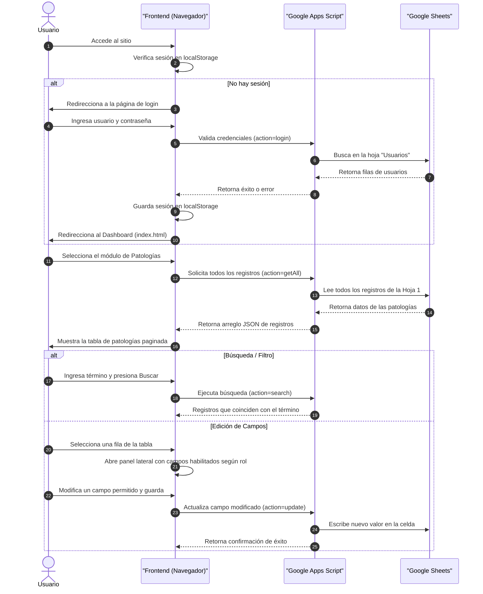
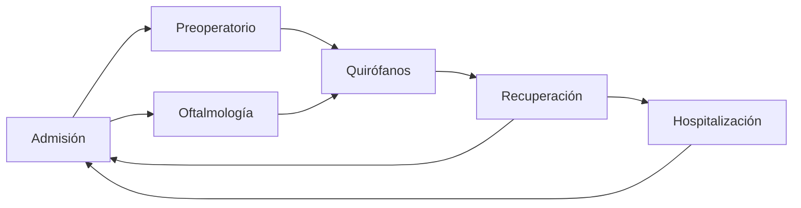
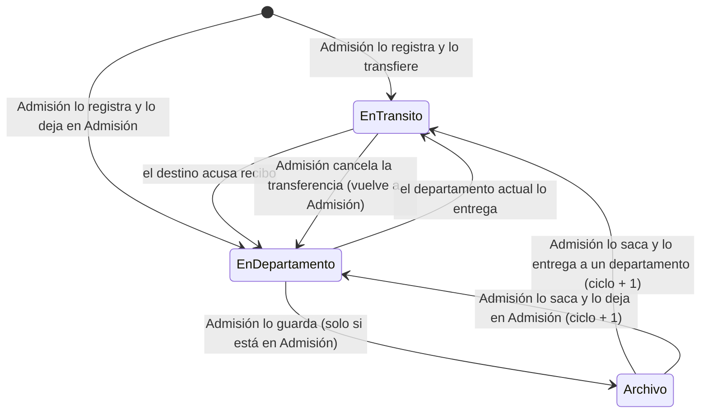

# Sistema de Gestión — Centro Médico San Lucas

Este proyecto es una aplicación web estática que agrupa los módulos operativos del **Centro Médico San Lucas**. Utiliza **Google Sheets** como base de datos en tiempo real y **Google Apps Script (GAS)** como API REST.

Módulos actuales:

| Módulo | Página | Qué resuelve |
| :--- | :--- | :--- |
| **Patologías** | `patologias.html` | Registro y seguimiento de estudios de patología. |
| **Bitácora de Expedientes** | `bitacora.html` | Rastreo del expediente clínico físico entre departamentos y tiempo que permanece en cada uno. Ver [sección 6](#6-módulo-bitácora-de-expedientes). |

---

## 1. Arquitectura y Conexiones

El sistema está dividido en dos capas principales: el frontend web (cliente) y el backend en la nube (servidor y base de datos).

### Detalles de la Conexión:
- **Protocolo de Comunicación**: El cliente se conecta al backend mediante peticiones HTTP `GET`.
- **Evasión de Limitaciones CORS**: Para evitar problemas de políticas de mismo origen (CORS) en el navegador, Google Apps Script devuelve las respuestas utilizando `ContentService` para servir un flujo de datos JSON (`ContentService.MimeType.JSON`).
- **Mecanismo de Reintento (Retry Logic)**: Debido a que Google Apps Script puede experimentar "arranques en frío" (cold-starts) o errores de red transitorios (devolviendo estados HTTP `404` o `>=500`), el cliente (en `js/api.js` y `js/auth.js`) implementa una función `fetchWithRetry` que realiza hasta 2 reintentos con un retraso exponencial automático antes de dar por fallida la operación.

---

## 2. Flujo de Trabajo (Workflow)

El flujo típico del usuario dentro de la aplicación sigue los siguientes pasos:

---

## 3. Gestión de Roles y Permisos

### Acceso a módulos

| Usuario | Patologías | Bitácora de Expedientes |
| :--- | :---: | :---: |
| **admin** | ✅ | ✅ |
| **admision** | ✅ | ✅ |
| **farmacia** | ✅ | ❌ |
| **contabilidad** | ✅ | ❌ |
| **preoperatorio**, **oftalmologia**, **quirofanos**, **recuperacion**, **hospitalizacion** | ❌ | ✅ |

Ambas reglas **fallan cerrado**: un usuario entra solo si está mapeado explícitamente.

* **Patologías** → tener secciones en `PERMISSIONS` de `js/config.js` (`tieneAccesoPatologias()` en `js/auth.js`).
* **Bitácora** → tener departamento en `USUARIO_DEPTO` o ser superusuario (`tieneAccesoBitacora()` en `js/bitacora/config.js`).

Un usuario que se agregue a la hoja `Usuarios` sin mapearlo en ninguno de los dos no ve ningún módulo, y el dashboard le indica que pida acceso a Sistemas.

El bloqueo actúa en dos puntos en cada módulo: la tarjeta se elimina del dashboard, y la página arranca oculta y redirige al dashboard si el usuario no tiene acceso, así que entrar por URL directa no muestra nada.

> [!IMPORTANT]
> Es un control de **interfaz**. La API de Patologías (`getAll`, `search`, `update`, `create`) no recibe ni valida el usuario, igual que las consultas de la bitácora; quien conozca la URL del Apps Script podría llamarla a mano. Las escrituras de la bitácora sí validan el usuario en el backend.

### Secciones editables en Patologías

El sistema implementa un control de acceso basado en el nombre de usuario (normalizado a minúsculas y sin acentos). Este control define qué secciones del registro de patología son **editables** por cada perfil en el panel lateral.

Las secciones de campos definidas en el sistema son:
1. **Identificación**: Datos básicos (`Folio`, `Expediente`, `Nombre del Paciente`).
2. **Patología**: Detalles clínicos (`Nivel o Tipo de Patología`, `Fecha de entrega`, `Fecha de recepción de resultados digitales`, `Fecha de recepción de resultados físicos`, `Fecha Revisión del Médico`).
3. **Cita**: Seguimiento médico (`Requiere Cita`, `Fecha Cita`).
4. **Seguimiento**: Control de entrega (`Fecha de envío a Paciente`).
5. **Contabilidad**: Información financiera (`Monto`, `Fecha Pago Contabilidad`).

### Matriz de Permisos (Configurada en `js/config.js`):

| Usuario / Rol | Identificación | Patología | Cita | Seguimiento | Contabilidad | ¿Crear Nuevo Registro? |
| :--- | :---: | :---: | :---: | :---: | :---: | :---: |
| **admin** |  |  |  |  |  | **Sí** |
| **farmacia** |  |  |  |  | ❌ | **Sí** |
| **admision** | ❌ | ❌ |  |  | ❌ | **No** |
| **contabilidad** | ❌ | ❌ | ❌ | ❌ |  | **No** |

> [!NOTE]
> Si un usuario intenta editar una sección para la cual no tiene permisos, el panel lateral renderizará dichos campos como **de sólo lectura (readonly)** y mostrará un icono de candado () al lado de la sección.

---

## 4. Estructura del Proyecto

El repositorio está organizado de la siguiente manera:

*   **`index.html`**: El portal o Dashboard inicial del sistema que presenta los módulos de trabajo disponibles.
*   **`login.html`**: Interfaz de acceso para el inicio de sesión.
*   **`patologias.html`**: La vista principal del módulo de patologías, conteniendo la tabla de datos, barra de búsqueda, chips de filtros rápidos y el contenedor del panel lateral de edición.
*   **`bitacora.html`**: Vista del módulo de bitácora de expedientes clínicos.
*   **`apps_script/Codigo.gs`** *(fuera del repositorio, ver `.gitignore`)*: Copia local del backend — Patologías (`getAll`, `search`, `update`, `create`, `login`) y Bitácora (acciones `bit*`). El código real vive en el editor de Google Apps Script; esta carpeta es solo una copia de trabajo y **no se sirve desde GitHub Pages**.
*   **`css/`**: Hojas de estilo. `styles.css` contiene los tokens y componentes compartidos; `bitacora.css` añade lo específico del módulo de bitácora (línea de tiempo, insignias de estado, barras de resumen).
*   **`img/`**: Recursos gráficos de la aplicación (como el logotipo del Centro Médico).
*   **`js/`**: Archivos JavaScript de lógica en el cliente organizados de forma modular:
    *   [config.js](file:///c:/Users/Sistemas/Documents/AppScript/patologias_page/js/config.js): Archivo centralizado de configuración. Contiene la `API_URL` de Google Apps Script, la definición de campos (`FIELDS`), la matriz de permisos de usuario (`PERMISSIONS`) y el mapeo entre las claves internas de JS y los encabezados de la hoja de cálculo (`KEY_MAP`).
    *   [api.js](file:///c:/Users/Sistemas/Documents/AppScript/patologias_page/js/api.js): Contiene las funciones de comunicación HTTP con la API de Apps Script (`apiFetch`, `apiUpdateField`, `apiCreateRecord`) e integra la lógica de reintentos.
    *   [auth.js](file:///c:/Users/Sistemas/Documents/AppScript/patologias_page/js/auth.js): Maneja el estado de la sesión activa en el `localStorage`, el flujo de autenticación contra la base de datos y la verificación de permisos específicos del rol.
    *   [utils.js](file:///c:/Users/Sistemas/Documents/AppScript/patologias_page/js/utils.js): Funciones utilitarias para formatear fechas en formato local (es-MX), formatear montos monetarios, renderizar distintivos visuales (pills) para valores booleanos y normalizar los registros del servidor.
    *   [table.js](file:///c:/Users/Sistemas/Documents/AppScript/patologias_page/js/table.js): Controla el renderizado de la tabla interactiva de resultados en el DOM y gestiona el sistema de paginación del lado del cliente.
    *   [panel.js](file:///c:/Users/Sistemas/Documents/AppScript/patologias_page/js/panel.js): Controla el comportamiento del panel lateral derecho (abrir, cerrar, recopilar valores modificados y renderizar los campos según la matriz de permisos).
    *   [main.js](file:///c:/Users/Sistemas/Documents/AppScript/patologias_page/js/main.js): Orquestador general del módulo de patologías. Vincula los eventos del DOM (búsquedas, filtros rápidos, guardado y creación de registros) con el comportamiento de los demás módulos JavaScript.
    *   **`js/bitacora/`**: Módulo de bitácora de expedientes. Reutiliza `auth.js`, `utils.js` y la paginación de `table.js` del módulo de patologías.
        *   [config.js](js/bitacora/config.js): Catálogo de departamentos, ubicación del archivo, flujo sugerido, mapa usuario→departamento y funciones de permiso (`puedeEntregar`, `puedeRecibir`, `puedeArchivar`, `puedeSacarDeArchivo`…).
        *   [api.js](js/bitacora/api.js): Llamadas a las acciones `bit*` de Apps Script, con la misma lógica de reintentos.
        *   [render.js](js/bitacora/render.js): Formato de fechas y duraciones, tabla de expedientes y línea de tiempo del recorrido.
        *   [main.js](js/bitacora/main.js): Orquestador del módulo: carga, filtros, panel lateral y ejecución de movimientos.

---

## 5. Estructura de las Hojas de Cálculo (Base de Datos)

El libro de Google Sheets debe contener las siguientes hojas. Las dos primeras son del módulo de Patologías; `Expedientes` y `Bitacora` las crea automáticamente la función `bitInstalar` del script de Apps Script.

### Hoja 1: `Hoja 1` (Registros de Patologías)
Contiene la base de datos de los pacientes. Los encabezados en la fila 1 deben coincidir **exactamente** con el siguiente orden y nombre:

| Columna | Nombre del Encabezado (Fila 1) | Descripción |
| :--- | :--- | :--- |
| **A** | `Folio` | Identificador único del estudio (obligatorio). |
| **B** | `Expediente` | Número de expediente del paciente. |
| **C** | `Nombre del Paciente` | Nombre completo del paciente. |
| **D** | `Nivel o Tipo de Patología` | Clasificación o nivel de la patología. |
| **E** | `Fecha de entrega` | Fecha de entrega del estudio al laboratorio. |
| **F** | `Fecha de recepción de resultados` | Fecha de recepción de resultados digitales. |
| **G** | `Patología Física Recibida` | Fecha de recepción física de los resultados. |
| **H** | `Fecha Revisión del Médico` | Fecha en la que el médico revisó el resultado. |
| **I** | `Requiere Cita` | Indica si requiere cita de seguimiento (`Sí` / `No`). |
| **J** | `Fecha Cita` | Fecha programada para la cita. |
| **K** | `Enviado a Paciente` | Fecha en que se le enviaron los resultados al paciente. |
| **L** | `Monto` | Monto del estudio. |
| **M** | `Fecha Pago Contabilidad` | Fecha de registro de pago en contabilidad. |

> [!NOTE]
> Además de las anteriores, la hoja debe tener una columna con encabezado `ID` (identificador autoincremental). `handleUpdate` y `handleCreate` la buscan por nombre, así que puede estar en cualquier posición, pero si falta ambas operaciones fallan.

### Hoja 2: `Usuarios` (Credenciales del Personal)
Contiene las credenciales para la autenticación de usuarios.

| Columna | Nombre del Encabezado (Fila 1) | Descripción |
| :--- | :---: | :--- |
| **A** | `Usuario` | Nombre de usuario. |
| **B** | `Clave` | Contraseña asignada al usuario. |

Usuarios esperados por el sistema:

| Usuario | Patologías | Bitácora |
| :--- | :--- | :--- |
| `admin` | Todas las secciones + crear | Superusuario: opera a nombre de cualquier departamento y puede deshacer |
| `farmacia` | Identificación, Patología, Cita + crear | **Sin acceso** |
| `contabilidad` | Contabilidad | **Sin acceso** |
| `admision` | Cita, Seguimiento | Departamento **Admisión** |
| `preoperatorio` | — | Departamento **Preoperatorio** |
| `oftalmologia` | — | Departamento **Oftalmología** |
| `quirofanos` | — | Departamento **Quirófanos** |
| `recuperacion` | — | Departamento **Recuperación** |
| `hospitalizacion` | — | Departamento **Hospitalización** |

> [!IMPORTANT]
> Los cinco usuarios de departamento son **nuevos**: hay que darlos de alta manualmente en la hoja `Usuarios` para que el módulo de bitácora funcione. Como no aparecen en la matriz `PERMISSIONS` de `js/config.js`, en el módulo de Patologías no pueden editar nada, que es el comportamiento deseado.

### Hoja 3: `Expedientes` (Estado actual de cada expediente)
Una fila por expediente. Refleja **dónde está ahora**; el historial vive en la hoja `Bitacora`.

| Columna | Encabezado | Descripción |
| :--- | :--- | :--- |
| **A** | `ID` | UUID interno. |
| **B** | `Expediente` | Número de expediente (clave única, se guarda en mayúsculas). |
| **C** | `Nombre del Paciente` | Nombre completo. |
| **D** | `Departamento Actual` | Dónde está el expediente: un departamento, o `Archivo`. Si va en tránsito, el lugar del que salió. |
| **E** | `Estado` | `En departamento` · `En tránsito` · `Archivo`. |
| **F** | `Destino Pendiente` | Solo cuando está en tránsito: a quién va dirigido. |
| **G** | `Fecha Apertura` | ISO 8601. Inicio del ciclo actual (primera salida, o salida del archivo). |
| **H** | `Última Actualización` | ISO 8601. Base del cálculo de "tiempo sin moverse". |
| **I** | `Fecha Cierre` | ISO 8601. **Fecha en que se guardó en el archivo.** Vacía mientras el ciclo está activo. (Conserva su nombre original para no romper hojas existentes.) |
| **J** | `Total Movimientos` | Contador de pasos del ciclo actual, incluido el paso al archivo. |
| **K** | `Ciclo` | Se incrementa cada vez que un expediente sale del archivo. |
| **L** | `Observaciones` | Texto libre. |

### Hoja 4: `Bitacora` (Historial de movimientos)
Una fila por **entrega**. Es la tabla que responde "¿por dónde pasó y cuánto tardó?".

| Columna | Encabezado | Descripción |
| :--- | :--- | :--- |
| **A** | `ID` | UUID del movimiento. |
| **B** | `Expediente` | Número de expediente. |
| **C** | `Origen` | Departamento que entrega, o `Archivo` cuando el expediente sale de ahí. |
| **D** | `Destino` | Departamento que recibe, o `Archivo` en el paso de archivado. |
| **E** | `Fecha Entrega` | ISO 8601. |
| **F** | `Usuario Entrega` | Quién registró la salida. |
| **G** | `Fecha Recepción` | ISO 8601. Vacío mientras nadie acuse recibo. En una transferencia cancelada, es la **fecha de cancelación**. |
| **H** | `Usuario Recepción` | Quién confirmó la llegada (o quién canceló la transferencia). |
| **I** | `Minutos Traslado` | `Fecha Recepción − Fecha Entrega`. Tiempo que el expediente anduvo "en el aire". |
| **J** | `Minutos Estancia Destino` | Tiempo que el expediente permaneció en `Destino`. Se calcula cuando sale de ahí. En el paso de archivado, es el **tiempo que pasó en el archivo**. En una transferencia cancelada, es el tiempo que pasó **de vuelta en Admisión**. |
| **K** | `Estado Movimiento` | `En tránsito` · `Recibido` · `Archivado` · `Transferencia cancelada` · `Cancelado`. |
| **L** | `Ciclo` | Ciclo al que pertenece el movimiento. |
| **M** | `Observaciones` | Texto libre de entrega, recepción y cancelación. |
| **N** | `Motivo Cancelación` | `Cancelación de la cirugía` o `Cancelación de la consulta`. Vacío en los demás movimientos. Si la hoja se creó con una versión anterior, el encabezado se agrega solo en la siguiente operación. |

> [!TIP]
> Con las columnas **I** y **J** puedes armar tablas dinámicas directamente en Sheets: promedio de estancia por departamento, cuellos de botella por mes, o traslados que tardaron más de X minutos.

---

## 6. Módulo: Bitácora de Expedientes

Resuelve el problema de los expedientes clínicos físicos que se pierden entre departamentos: registra cada movimiento, quién lo entregó, quién lo recibió y cuánto tiempo estuvo en cada lugar.

### 6.1 Modelo: entrega + acuse de recibo

Cada traslado son **dos registros**, no uno:

1. El departamento que tiene el expediente registra **a quién se lo entrega**.
2. El departamento destino **confirma que lo recibió**.

Entre ambos momentos el expediente queda `En tránsito`: salió de un lado y nadie ha confirmado que llegó al otro. Ese es exactamente el hueco donde se pierden, y el sistema lo muestra en amarillo con el filtro *"En tránsito (sin acuse)"*.

### 6.2 Flujo del expediente

El flujo es una **sugerencia, no una restricción**: el panel preselecciona el siguiente paso habitual bajo el grupo *"Siguiente paso habitual"*, pero cualquier departamento puede aparecer como destino en *"Otros departamentos"*. La realidad del hospital no siempre sigue el camino ideal y forzarlo solo provocaría que se dejen de registrar movimientos.

El ciclo termina cuando el expediente regresa a Admisión y Admisión lo **guarda en el archivo**.

#### Registrar un expediente nuevo

Al registrar uno o varios expedientes con **"Nuevo expediente"**, Admisión debe elegir qué hacer con ellos; no hay opción preseleccionada para que nadie mande un expediente a un departamento sin decidirlo:

| Opción | Resultado |
| :--- | :--- |
| **Transferir a otro departamento** | Aparece la lista de departamentos. El expediente sale `En tránsito` y el destino debe acusar recibo. |
| **Dejar en Admisión** | El expediente queda `En departamento` en Admisión. Se registra un paso `Admisión → Admisión` con acuse inmediato (en la línea de tiempo: *"Registrado en Admisión"*), así el tiempo que pasa ahí se mide y la siguiente entrega lo cierra. Después se transfiere o se archiva desde su panel, como cualquier otro. |

La misma elección aplica al sacar un expediente del archivo desde este panel. En el modo **Varios a la vez** la opción se aplica a todos los renglones.

### 6.2.1 El archivo

El archivo **no es un departamento**: es una ubicación propia. Un expediente archivado no está en Admisión ni en ningún otro lado — está guardado. Las reglas:

* **Solo Admisión mete** expedientes al archivo, y solo cuando ya regresaron físicamente a Admisión. No se puede archivar algo que sigue en otro departamento ni algo en tránsito.
* **Solo Admisión saca** expedientes del archivo. Ningún otro departamento puede moverlos, ni siquiera "entregarlos": `Archivo` no aparece como destino en ninguna lista.
* Archivar se registra como **un paso más del recorrido** (`Admisión → Archivo`), con acuse inmediato porque quien lo deposita es quien lo recibe. Así el tiempo que pasa guardado se mide igual que la estancia en cualquier departamento, y aparece en la línea de tiempo.
* Estar quieto en el archivo es lo esperado: los archivados **nunca disparan la alerta** de detenidos, y no aparecen en la lista de trabajo salvo que se marque *"Incluir expedientes en archivo"* o se filtre la ubicación por `Archivo`.
* Para Admisión, el filtro *"En mi departamento"* incluye el archivo (es su custodia) y también lo que acaba de sacar y va en camino a otro departamento, igual que cuando manda uno nuevo.

### 6.2.2 Cuando el paciente regresa

No se da de alta otra vez: el expediente ya existe y se **saca del archivo**. Al sacarlo se abre un **ciclo nuevo** conservando íntegro el historial anterior. Hay dos caminos:

* **Desde el expediente**: buscarlo por número (la búsqueda sí muestra los archivados) y usar **"Sacar del archivo"** en el panel. Se elige entre **dejarlo en Admisión** (para consulta o trámite; queda recibido ahí de inmediato) o **entregarlo directamente** a un departamento.
* **Desde "Nuevo expediente"** (uno o varios a la vez): al escribir un número que está en el archivo, el nombre se completa solo y se avisa que se sacará y qué ciclo se abrirá. Si el expediente sigue en circulación, el aviso lo señala y el guardado se bloquea.

> [!IMPORTANT]
> Al sacarlo, el backend **conserva el nombre ya registrado e ignora el que venga en la petición**. Es deliberado: si Admisión reescribiera *"Maria Vasquez"* donde decía *"María Elena Vázquez Ruiz"*, el nombre bueno se perdería y las búsquedas por nombre dejarían de encontrar el expediente. Para corregir un nombre mal capturado se edita la celda en la hoja `Expedientes`.

### 6.2.3 Cancelar una transferencia

Cuando se cancela la cirugía o la consulta, el expediente que Admisión ya mandó no debe seguir esperando acuse en Preoperatorio u Oftalmología. Admisión abre el expediente y usa **"Cancelar transferencia"**; al elegirlo aparecen los dos motivos posibles y el botón de confirmar se habilita solo cuando se marca uno:

* **Cancelación de la cirugía**
* **Cancelación de la consulta**

Reglas:

* **Solo Admisión** (y `admin`) cancela, y solo transferencias **en tránsito sin acuse** que salieron de Admisión o del archivo. Si el destino ya acusó recibo, el expediente se regresa con una entrega normal a Admisión. Una entrega entre otros departamentos (p. ej. Preoperatorio → Quirófanos) la resuelve quien la hizo.
* El expediente **regresa a Admisión** (`En departamento`), también si había salido del archivo: el papel está en sus manos. Desde ahí se puede volver a entregar o guardar otra vez en el archivo. El ciclo no cambia.
* El paso **no se borra ni se tacha**: queda en el recorrido como `Transferencia cancelada`, con el motivo en la columna **N**, quién y cuándo canceló, cuánto alcanzó a estar en tránsito y cuánto lleva de vuelta en Admisión.
* También en **lote**: al seleccionar varios aparece `Cancelar transferencia (n)` en la barra; abre el panel con los mismos dos motivos, que se aplican a todos.
* El departamento destino recibe un aviso en su siguiente refresco — *"Admisión canceló el envío del expediente 10432… Si ya lo tienes, devuélvelo a Admisión."* — y su contador de pendientes baja solo.

No es lo mismo que **Deshacer** (§6.8): deshacer corrige un error de captura y deja el paso como `Cancelado` (tachado, como si no hubiera ocurrido). La cancelación sí ocurrió y forma parte del historial clínico-administrativo.

### 6.3 Ciclo de vida y reglas de permiso

| Acción | Quién puede |
| :--- | :--- |
| Registrar la primera salida | `admision`, `admin` |
| Registrar una entrega | Únicamente el departamento donde está el expediente, o `admin` |
| Confirmar recepción | Únicamente el departamento destino, o `admin` |
| Guardar en el archivo | `admision`, `admin` — y solo si el expediente ya regresó a Admisión |
| Sacar del archivo | `admision`, `admin` |
| Cancelar una transferencia | `admision`, `admin` — solo envíos de Admisión o del archivo, en tránsito sin acuse, y con motivo |
| Deshacer el último paso | `admin` |
| Abrir el módulo y consultar | Solo usuarios con departamento asignado en `USUARIO_DEPTO`, más `admin` |

`tieneAccesoBitacora()` decide quién entra, y la regla **falla cerrado**: se requiere tener departamento asignado o ser superusuario. `farmacia` y `contabilidad` quedan fuera por no aparecer en `USUARIO_DEPTO`, sin necesidad de mantener una lista negra — y cualquier usuario que se agregue a la hoja `Usuarios` sin mapearlo aquí tampoco entra por descuido.

El bloqueo actúa en dos puntos: la tarjeta del módulo se elimina del dashboard, y `bitacora.html` arranca oculta (`html.bit-verificando { visibility: hidden }`) y solo se destapa si el guard de `js/bitacora/main.js` aprueba al usuario. Así, entrar por URL directa no alcanza a mostrar nada.

Las reglas están escritas dos veces a propósito: en `js/bitacora/config.js` para ocultar botones, y en `Codigo.gs` para **validar de verdad**. El frontend es una comodidad; la autoridad es el backend, porque cualquiera puede llamar la URL de la API a mano.

### 6.4 Cómo se mide el tiempo

* **Traslado** = `Fecha Recepción − Fecha Entrega`. Cuánto tardó en llegar físicamente.
* **Estancia** = `Fecha Entrega del siguiente movimiento − Fecha Recepción`. Cuánto se quedó parado en ese departamento.

La estancia del departamento actual todavía no tiene un valor final, así que el panel la calcula contra el reloj y la muestra como *"(en curso)"*. Los minutos se congelan en la hoja de cálculo hasta que el expediente sale de ahí.

Todas las marcas de tiempo se guardan en **ISO 8601 UTC** y se convierten a hora local (`es-MX`, reloj de 24 h) al mostrarlas, para que no dependan de la zona horaria configurada en el proyecto de Apps Script.

### 6.5 Operaciones en lote

Un departamento rara vez mueve un expediente a la vez: Preoperatorio manda cinco a Quirófanos en la misma vuelta, y Admisión da de salida ocho en la mañana. Registrarlos de uno en uno es justo lo que hace que se deje de registrar.

**Mover varios que ya existen.** Cada renglón de la tabla tiene una casilla, y el encabezado marca toda la página visible. Al seleccionar algo aparece una barra con `Entregar`, `Confirmar recepción`, `Archivar` y, para Admisión, `Cancelar transferencia`.

Cada botón muestra **sobre cuántos de los seleccionados aplica de verdad** — `Confirmar recepción (3)` — y se deshabilita en cero. Mezclar expedientes en distinto estado es normal, y esconder ese número haría creer al usuario que movió más de lo que movió. Si todo lo entregable está en el mismo departamento, el selector de destino ofrece primero el siguiente paso habitual.

**Dar de alta varios nuevos.** El panel de *Nuevo expediente* tiene dos modos: **Un expediente** y **Varios a la vez**. En el segundo se capturan renglones de `número + nombre` que van al mismo lugar. Cada renglón consulta al salir del campo de número y se marca solo:

| Renglón | Qué pasa |
| :--- | :--- |
| Expediente nuevo | Se pide el nombre normalmente. |
| Está en el archivo | Completa el nombre solo y avisa *"En archivo · se saca y abre el ciclo 2"*. |
| Sigue en circulación | Se marca en rojo con dónde está, y bloquea el guardado hasta quitarlo. |

`Enter` en el campo de nombre del último renglón agrega otro, para capturar sin soltar el teclado.

#### Resultado parcial

Un lote **no es todo o nada**. Si 7 de 8 expedientes se movieron, esos 7 realmente cambiaron de lugar y revertirlos sería mentir sobre dónde están los papeles. El backend devuelve `procesados` y `fallidos` con el motivo de cada rechazo, y el panel lateral lo desglosa. Los que sí se procesaron se desmarcan; los rechazados **siguen seleccionados** para poder reintentarlos tras corregir.

#### Un solo motor

Las operaciones individuales y las de lote comparten el mismo código: una operación individual es un lote de un elemento. Las reglas de permiso y de estado están escritas una sola vez y no pueden desincronizarse entre ambos caminos.

El motor lee cada hoja **una vez**, muta en memoria y escribe al final. La versión anterior escribía celda por celda, lo que habría convertido un lote de 10 expedientes en cientos de llamadas a Sheets. Límites: **50 expedientes** por movimiento (`BIT_MAX_LOTE`) y **25** por alta múltiple (`BIT_MAX_ALTA`, el payload es mayor porque lleva los nombres).

### 6.6 Refresco automático

Apps Script **no puede notificar al navegador**: no hay websockets ni push desde Sheets. La única vía es que la página consulte cada cierto tiempo, así que el módulo hace *polling* — pero acotado para que no se note ni castigue la cuota del script.

Se configura en `AUTO_REFRESCO` de `js/bitacora/config.js`:

| Ajuste | Valor | Por qué |
| :--- | :--- | :--- |
| `SEGUNDOS` | `45` | Ritmo con la pestaña a la vista. Un expediente cambia de departamento cada varios minutos, no cada segundo. Bajarlo de 20 s no aporta y multiplica las llamadas. |
| `SEGUNDOS_OCULTA` | `120` | Ritmo con la pestaña en segundo plano (otra pestaña del navegador, o navegador minimizado). Más lento para cuidar la cuota, pero suficiente para que el título de la pestaña avise de llegadas. |
| `ACTIVO_POR_DEFECTO` | `true` | Se puede pausar desde la casilla *"Actualizar cada 45 s"* de la barra de filtros. |

Reglas que evitan que el refresco estorbe o desperdicie llamadas:

* **Más lento en segundo plano, no detenido.** El personal trabaja en otras pestañas la mayor parte del turno; si el refresco se detuviera ahí, nadie se enteraría de una llegada hasta volver a la bitácora. Al volver a la pestaña se pone al día de inmediato y regresa al ritmo de 45 s.
* **Freno anti-ráfaga.** Alternar pestañas dispara `visibilitychange` repetidamente; solo se consulta si los datos ya tienen media vuelta de antigüedad.
* **`setTimeout` encadenado, no `setInterval`.** Si Apps Script tarda (los arranques en frío pasan de 5 s) las llamadas no se encaballan.
* **No pisa una escritura en curso.** La bandera `guardando` bloquea el refresco mientras se registra un movimiento.
* **Conserva la búsqueda.** `vistaActual` recuerda si se está viendo la lista o un resultado de búsqueda, y el refresco repite la misma consulta en vez de devolver al usuario a la lista completa cada 45 s.
* **No destruye el panel abierto.** El refresco solo repinta la tabla; el panel lateral y lo que el usuario esté escribiendo en el campo de observaciones quedan intactos. La fila resaltada se vuelve a marcar tras repintar.
* **Si falla la red, no borra nada.** Un error en modo silencioso solo cambia el indicador a *"Sin conexión — se reintentará"*; la tabla se queda como estaba.

#### Aviso de llegadas

En cada refresco silencioso se comparan las firmas (`estado | departamento actual | destino pendiente | última actualización`) contra las de la vuelta anterior. Si aparece un expediente **dirigido a mi departamento** que antes no estaba o cambió, salta un aviso:

> *Recuperación te envió el expediente 10428 — Guadalupe Hernández Soto*

Además, el número de expedientes esperando mi acuse de recibo se escribe en el **título de la pestaña** — `(2) Centro Médico San Lucas — Bitácora…` — para que se vea aunque la bitácora esté en segundo plano, que es donde va a estar la mayor parte del turno.

Si la llegada se detecta con la pestaña oculta, el aviso emergente no se muestra en ese momento (desaparecería sin que nadie lo vea). En su lugar el título gana una marca — `● (3) Centro Médico…` — y el aviso se muestra al volver a la pestaña, solo para los expedientes que sigan esperando acuse.

> [!NOTE]
> Edge ("pestañas en suspensión") y Chrome ("ahorro de memoria") pueden dormir una pestaña que lleva mucho tiempo sin usarse; dormida, deja de consultar. Si pasa, conviene agregar el sitio a la lista de excepciones del navegador (*Configuración → Sistema y rendimiento* en Edge, *Rendimiento* en Chrome).

> [!NOTE]
> Cada consulta lee la hoja `Expedientes` completa. Con los volúmenes de una clínica esto es irrelevante durante años, pero si algún día la hoja llega a decenas de miles de filas, el refresco se irá haciendo lento. La palanca es subir `SEGUNDOS`.

### 6.7 Alertas

Configurables en la constante `ALERTA` de `js/bitacora/config.js`:

| Situación | Umbral por defecto |
| :--- | :--- |
| En tránsito sin acuse de recibo | 60 minutos |
| Detenido en un mismo departamento | 24 horas |

Al superarse, la fila se pinta de ámbar con un ⚠ y el expediente aparece en el contador *"Detenidos"* y en su filtro.

### 6.8 Deshacer

Solo el superusuario, y de un nivel. Revierte el último paso respetando su granularidad real:

| Último paso registrado | Qué hace deshacer |
| :--- | :--- |
| Transferencia cancelada | Vuelve a dejarlo `En tránsito` hacia el destino original y borra el motivo |
| Registro en Admisión (alta sin transferir) | Anula el paso; el expediente sigue en Admisión, sin movimientos |
| Salida del archivo | Lo devuelve al archivo: recupera su fecha de archivo, el ciclo anterior y su contador. Aplica tanto si iba en camino como si ya se había dejado en Admisión. |
| Guardado en el archivo | Lo regresa a Admisión y reabre su estancia ahí |
| Recepción | Vuelve a dejarlo `En tránsito` hacia el mismo destino |
| Entrega | Cancela la entrega y regresa el expediente a su origen |

Los pasos cancelados **no se borran**: quedan en la hoja con `Estado Movimiento = Cancelado` y se ven tachados en la línea de tiempo. La bitácora es un documento de control, así que conviene que las correcciones sean visibles.

### 6.9 Migración desde "Cerrado"

La versión anterior terminaba el ciclo con el estado `Cerrado` y dejaba el expediente figurando en Admisión. Al actualizar se corre `bitInstalar` desde el editor de Apps Script, que ejecuta `bitMigrarArchivo`. Por cada expediente cerrado:

* pasa a `Estado = Archivo` y `Departamento Actual = Archivo`;
* su último movimiento deja de marcarse `Cerrado` y queda `Recibido`, que es lo que realmente fue (la llegada a Admisión);
* se agrega el paso `Admisión → Archivo` con la **fecha de cierre original**, así el tiempo en archivo se mide desde ese día.

Es idempotente: correrla otra vez no encuentra nada que migrar. Aun sin migrar, el backend traduce `Cerrado` al leer, así que las filas viejas siguen funcionando; la migración solo deja la hoja limpia y agrega el paso de archivo para medir su tiempo. El backend también sigue aceptando las acciones viejas `bitCerrar`/`bitCerrarLote` para que un navegador con la página anterior en caché no falle durante el despliegue.